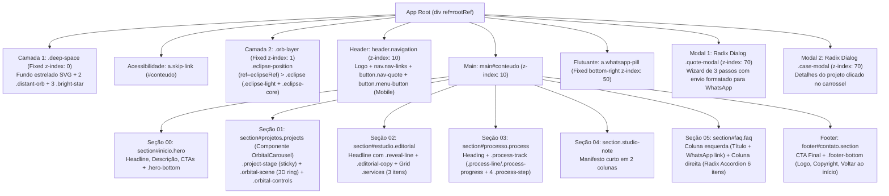

# Diagnóstico Técnico e Visual — UMBRA DIGITAL STUDIO

Este documento apresenta a auditoria técnica, visual e funcional completa dos materiais disponíveis no workspace para a reconstrução do site da **Umbra Digital Studio**, separando estritamente **fatos extraídos diretamente dos arquivos/vídeos** de **inferências técnicas**.

---

## 1. Análise dos Arquivos em `original-site/` e Tecnologias Identificadas

### 1.1 Inventário de Arquivos Recuperados (`original-site/`)

| Arquivo | Tamanho | Natureza Identificada (Fato) | Papel no Site Original |
| :--- | :--- | :--- | :--- |
| [download](file:///c:/Users/lucas/Downloads/Sites/Nova%20Umbra/original-site/download) | 31.424 B | Documento HTML SSR + Payload RSC | HTML inicial renderizado no servidor (`lang="pt-BR"`) contendo toda a marcação estática da *landing page*, hidratação RSC (`vinext.navigationRuntime`) e script injetado da Cloudflare. |
| [index.CNir8t_H.css](file:///c:/Users/lucas/Downloads/Sites/Nova%20Umbra/original-site/index.CNir8t_H.css) | 168.149 B | Folha de estilos CSS compilada | Contém **Tailwind CSS v4.2.1** (layers, utilitários e `@property`) + variáveis de tema (`shadcn/ui`) + **CSS autoral completo** do projeto (a partir do byte `~126.200`). |
| [page-DegWFxUv.js](file:///c:/Users/lucas/Downloads/Sites/Nova%20Umbra/original-site/page-DegWFxUv.js) | 228.718 B | Bundle JS da página principal (`/`) | Contém **GSAP 3.15.0**, **ScrollTrigger 3.15.0**, primitivos **Radix UI** (`Dialog`, `Accordion`, `RadioGroup`), ícones **Lucide React**, `clsx` + `tailwind-merge` + `class-variance-authority` (CVA) e os componentes da página (`Eg` como `default`, `gg` como carrossel orbital 3D). |
| [framework-D_rUT4EX.js](file:///c:/Users/lucas/Downloads/Sites/Nova%20Umbra/original-site/framework-D_rUT4EX.js) | 190.152 B | Bundle do React Runtime | **React 19.2.6** (`react` + `react-dom/client` + `react/jsx-runtime`). |
| [index-BOKNp04j.js](file:///c:/Users/lucas/Downloads/Sites/Nova%20Umbra/original-site/index-BOKNp04j.js) | 192.301 B | Runtime de roteamento/RSC | Runtime cliente do **vinext** (implementação Next.js App Router sobre Vite/Rolldown) + `react-server-dom` (`1.0.0-beta.5`). |
| [layout-segment-context-BNKFOmoE.js](file:///c:/Users/lucas/Downloads/Sites/Nova%20Umbra/original-site/layout-segment-context-BNKFOmoE.js) | 494 B | Contexto de segmento de layout | Provedor `LayoutSegmentProvider` do App Router. |
| [rolldown-runtime-C60lm6uB.js](file:///c:/Users/lucas/Downloads/Sites/Nova%20Umbra/original-site/rolldown-runtime-C60lm6uB.js) | 694 B | Runtime ESM do bundler | Helpers de interoperabilidade ESM/CJS gerados pelo **Rolldown** (bundler Rust do ecossistema Vite). |
| [main.js](file:///c:/Users/lucas/Downloads/Sites/Nova%20Umbra/original-site/main.js) e [main2.js](file:///c:/Users/lucas/Downloads/Sites/Nova%20Umbra/original-site/main2.js) | 43.252 B (cada) | Script externo de proteção Cloudflare | **Não fazem parte do código do site.** São cópias idênticas (mesmo hash SHA-256) do script ofuscado `window._cf_chl_opt` (`/cdn-cgi/challenge-platform/.../scripts/jsd/main.js`) injetado pelo domínio de hospedagem temporária (`*.chatgpt.site`). Devem ser descartados na reconstrução. |

### 1.2 Stack Tecnológica (Confirmado vs. Inferido)

- **Confirmado nos arquivos:**
  - **React `19.2.6`** com App Router structure (`layout:/`, `page:/`).
  - **Bundler / Framework:** `vinext` (Vite + Rolldown emulando Next.js App Router, evidenciado por `Symbol.for("vinext.navigationRuntime")`, `data-precedence="vite-rsc/importer-resources"`, `<meta name="codex-preview" content="development"/>` e URL `umbra-orbital-studio.lucascarvalho35122.chatgpt.site` vista em `referencia-02.mp4`).
  - **Estilização:** **Tailwind CSS `v4.2.1`** combinado com **CSS puro escopado por classes semânticas** (`.hero`, `.orb-layer`, `.eclipse`, `.orbital-scene`, `.satellite-card`, `.editorial`, `.process`, `.studio-note`, `.faq`, `.quote-modal`, etc.).
  - **Componentes de UI (estilo `shadcn/ui` sobre Radix UI):**
    - `@radix-ui/react-dialog` (`data-slot="dialog"`, `dialog-overlay`, `dialog-content`, `dialog-title`, `dialog-description`, `dialog-close`).
    - `@radix-ui/react-accordion` (`data-slot="accordion"`, `accordion-item`, `accordion-trigger`, `accordion-content`, modo `type="single" collapsible={true}`).
    - `@radix-ui/react-radio-group` (`data-slot="radio-group"`, `radio-group-item`, `radio-group-indicator`).
    - Utilitários `clsx`, `tailwind-merge` e `class-variance-authority` (CVA).
  - **Ícones:** **Lucide React** (`ArrowUpRight`, `ArrowDown`, `ArrowLeft`, `ArrowRight`, `ChevronDown`, `Circle`, `Menu`, `X`) + SVG inline customizado para o ícone do WhatsApp (`Tg`).
  - **Animações:** **GSAP `3.15.0`** + plugin **ScrollTrigger `3.15.0`** (`gsap.registerPlugin(ScrollTrigger)`, `gsap.matchMedia()`, `gsap.context()`, `gsap.quickSetter()`).
- **Inferência técnica:**
  - O projeto original foi gerado/hospedado em ambiente de preview (`codex-preview` / `chatgpt.site`), onde componentes padrão `shadcn/ui` (`Accordion`, `Dialog`, `RadioGroup`, `Button`) foram importados, mas a maior parte do layout visual foi escrita em um arquivo CSS global (`globals.css` / `index.css`) usando classes semânticas tradicionais em vez de classes utilitárias Tailwind no JSX.

---

## 2. Exame dos Recursos em `public/`

Todos os 7 arquivos em `public/` são imagens PNG em alta resolução (totalizando ~12,1 MB):

### 2.1 Identidade Visual (`public/brand/`)
1. **[favicon.png](file:///c:/Users/lucas/Downloads/Sites/Nova%20Umbra/public/brand/favicon.png)** (`1294 × 1216 px`, `1,32 MB`):
   - Ícone quadrado de cantos arredondados (estilo *squircle* com borda azul elétrica brilhante) em fundo preto absoluto, contendo o eclipse negro com anel de luz azul elétrico à direita e ponto de fulgor (*lens flare* horizontal) no equador direito.
   - *Observação:* No HTML original ([download](file:///c:/Users/lucas/Downloads/Sites/Nova%20Umbra/original-site/download)), o `<head>` apontava para `/favicon.svg` (inexistente), enquanto temos `public/brand/favicon.png`.
2. **[og-image.png](file:///c:/Users/lucas/Downloads/Sites/Nova%20Umbra/public/brand/og-image.png)** (`1733 × 907 px`, `1,64 MB`):
   - Imagem Open Graph panorâmica com fundo de nebulosa azul escura e estrelas, o grande eclipse luminoso à esquerda e à direita o logotipo `UMBRA` (branco, espaçado, com o `A` estilizado como chevron `Λ`), subtítulo `DIGITAL STUDIO` em azul elétrico e tagline `"Ideias ganham forma digital."`.
   - *Observação:* Não estava referenciada nas meta tags `<meta property="og:image">` do HTML original — excelente oportunidade de inclusão na reconstrução.
3. **[umbra-logo.png](file:///c:/Users/lucas/Downloads/Sites/Nova%20Umbra/public/brand/umbra-logo.png)** (`2162 × 727 px`, `1,18 MB`):
   - Logotipo horizontal completo sobre fundo preto sólido: ícone do eclipse à esquerda + `UMBRA` em branco + `DIGITAL STUDIO` em azul elétrico.
   - *Como é usado no CSS original:* Renderizado com `width="145" height="46"` (`125px` no mobile) e `mix-blend-mode: screen` (`.brand img { mix-blend-mode: screen; width: 145px; height: auto }`) para remover visualmente o fundo preto da imagem PNG sobre o fundo do site.

### 2.2 Imagens de Projetos (`public/projects/`)
> [!IMPORTANT]
> **Descoberta Crítica sobre os Projetos:** No código compilado ([page-DegWFxUv.js](file:///c:/Users/lucas/Downloads/Sites/Nova%20Umbra/original-site/page-DegWFxUv.js)) e nos vídeos de referência, o carrossel orbital exibe apenas **3 projetos em cards puramente tipográficos** (`TopClean`, `Barbearia Tatuí`, `Valença & Montoro`) e **não carrega nenhuma imagem**. Porém, a pasta `public/projects/` contém **4 imagens de altíssima qualidade** (incluindo `noir.png`, um estúdio de tatuagem).

1. **[topclean.png](file:///c:/Users/lucas/Downloads/Sites/Nova%20Umbra/public/projects/topclean.png)** (`1536 × 1024 px`, `2,36 MB`):
   - Fotografia/render hiper-realista de uma BMW Série 3 preta espelhada em um estúdio de estética automotiva (*detailing*) escuro iluminado por tubos de LED azuis e brancos refletindo no piso molhado. Corresponde ao projeto **01 — TopClean (Estética automotiva)**.
2. **[barbearia.png](file:///c:/Users/lucas/Downloads/Sites/Nova%20Umbra/public/projects/barbearia.png)** (`1672 × 941 px`, `1,91 MB`):
   - Cena cinematográfica de um barbeiro tatuado com avental de couro e luvas pretas cortando o cabelo de um cliente em uma barbearia sofisticada de iluminação âmbar/dourada e madeira escura. Corresponde ao projeto **02 — Barbearia Tatuí (Barbearia contemporânea)**.
3. **[advocacia.png](file:///c:/Users/lucas/Downloads/Sites/Nova%20Umbra/public/projects/advocacia.png)** (`1672 × 941 px`, `1,87 MB`):
   - Estátua de bronze da Dama da Justiça (Têmis) segurando a balança e a espada no interior de um escritório de advocacia monumental em mármore negro, com luz dourada do pôr do sol e *skyline* urbano ao fundo. Corresponde ao projeto **03 — Valença & Montoro (Advocacia boutique)**.
4. **[noir.png](file:///c:/Users/lucas/Downloads/Sites/Nova%20Umbra/public/projects/noir.png)** (`1672 × 941 px`, `1,85 MB`):
   - Cena intimista em tons escuros e quentes de um tatuador utilizando máquina rotativa e luvas pretas tatuando o antebraço de um cliente em um estúdio de tatuagem (*Noir*). **Este quarto projeto está presente nos assets do projeto (`public/projects/noir.png` e mencionado no prompt como "imagens principais dos quatro projetos"), mas não estava cadastrado no array `Sg` do bundle original.**

---

## 3. Análise das Gravações em `references/`

Foram analisadas quadro a quadro as duas gravações em vídeo:

### 3.1 [referencia-01.mp4](file:///c:/Users/lucas/Downloads/Sites/Nova%20Umbra/references/referencia-01.mp4) (`00:25`, `2,17 MB`)
- **`00:00 – 00:03` (Hero Section):** Exibe o cabeçalho (`UMBRA`, links `Projetos`, `O estúdio`, `Processo`, `FAQ`, botão `Vamos conversar ↗`), o título `IDEIAS GANHAM FORMA DIGITAL.` (com `FORMA DIGITAL.` em azul `#0066ff`), o botão primário `SOLICITAR ORÇAMENTO ↗`, link `Ver projetos ↓`, a barra inferior da Hero (`UM ESTÚDIO. INFINITAS POSSIBILIDADES.`, `Explore a próxima órbita ↓`, `ESTRATÉGIA → EXPERIÊNCIA`) e o grande **Eclipse** posicionado à direita do texto, com seu halo azul pulsando suavemente (`halo-breathe`). No canto inferior direito, aparece a pílula fixa do WhatsApp (`FALAR COM A UMBRA`).
- **`00:04 – 00:09` (Modal de Orçamento):** O usuário clica em `SOLICITAR ORÇAMENTO ↗`. Abre-se o modal com fundo escuro (`#080c13`) e *backdrop blur*:
  - **Passo `01 / 03`** (`O que você precisa?`): Usuário seleciona `Site Institucional` (borda e fundo azul translúcido) e clica em `CONTINUAR →`.
  - **Passo `02 / 03`** (`Qual é o principal objetivo?`): Usuário seleciona `Divulgar produto` e clica em `CONTINUAR →`.
  - **Passo `03 / 03`** (`Conte um pouco sobre o projeto.`): Exibe `<textarea>` opcional e botão `CONTINUAR NO WHATSAPP ↗`. O usuário fecha o modal clicando fora/no `X`.
- **`00:10 – 00:14` (Scroll para Projetos & Carrossel Orbital 3D):** Ao rolar a página, o **Eclipse** viaja da direita da Hero para o **centro exato da tela** (`scale: 1.05`), ficando atrás dos cards da seção `01 — PROJETOS EM DESTAQUE` (`Projetos em outra órbita.`). A seção é *sticky* (`height: 220svh` com `.project-stage` em `position: sticky; top: 0; height: 100svh`). Conforme o scroll desce, os 3 cards (`01 / CASO REAL — TopClean`, `02 / CONCEITUAL — Barbearia Tatuí`, `03 / CONCEITUAL — Valença & Montoro`) orbitam em 3D ao redor do eclipse da direita para a esquerda.
- **`00:14 – 00:18` (Seções O Estúdio, Processo e Studio Note):**
  - Na seção `02 — UMA NOVA PERSPECTIVA`, o eclipse se desloca para o canto inferior direito em tamanho reduzido (`scale: 0.5, opacity: 0.35`), enquanto as 4 linhas do título (`Seu negócio / já funciona. / Seu site precisa / acompanhar.`) surgem com efeito de máscara vertical (`.reveal-line`). Abaixo, aparecem as 3 colunas de serviços (`01 / Sites institucionais`, `02 / Landing pages`, `03 / Manutenção & evolução`).
  - Na seção `03 — MÉTODO COM DIREÇÃO` (`Do primeiro pixel à publicação.`), o eclipse vai para a esquerda (`scale: 0.4, opacity: 0.3`) e a linha horizontal azul com brilho neon (`.process-progress`) preenche da esquerda para a direita através dos 4 passos (`01 Briefing`, `02 Estratégia & design`, `03 Desenvolvimento`, `04 Publicação`).
  - Na seção `04 — UMBRA DIGITAL STUDIO`, exibe a nota conceitual (`Entre uma boa ideia e uma presença marcante, existe intenção.`).
- **`00:19 – 00:25` (FAQ e Footer):**
  - Na seção `05 — FAQ`, o usuário clica na primeira pergunta (`Quanto custa criar um site?`). O ícone `+` à direita gira 90° transformando-se em `-` e o painel abre exibindo a resposta.
  - No rodapé (`SUA PRÓXIMA FASE COMEÇA AQUI — Vamos dar forma à sua ideia?`), o eclipse volta a crescer (`scale: 0.95, opacity: 1`) posicionando-se à direita da chamada final.

### 3.2 [referencia-02.mp4](file:///c:/Users/lucas/Downloads/Sites/Nova%20Umbra/references/referencia-02.mp4) (`00:47`, `3,73 MB`)
- Mostra a barra de endereços do navegador (`umbra-orbital-studio.lucascarvalho35122.chatgpt.site`).
- **`00:02 – 00:19` (Fluxo Completo do Orçamento até o WhatsApp):** O usuário abre o modal de orçamento, escolhe `Site Institucional` → `Divulgar produto` → digita `"rthfhdhht"` no textarea do passo 3 e clica em `CONTINUAR NO WHATSAPP ↗`.
- Abre uma nova aba para `https://api.whatsapp.com/send/?phone=5515988311292&text=Ol%C3%A1%2C+Umbra%21+Gostaria+de+um+or%C3%A7amento.%0A%0AServi%C3%A7o%3A+Site+Institucional%0AObjetivo%3A+Divulgar+produto%0ASobre+o+projeto%3A+rthfhdhht`.
- **`00:20 – 00:39`:** O usuário retorna à aba do site, fecha o modal, percorre o carrossel orbital via scroll, passa pelas seções `02`, `03`, `04`, abre a pergunta `"O site funciona no celular?"` no FAQ (`05`), desce até o rodapé e clica em `"Voltar ao início ↑"`.
- **`00:40 – 00:47`:** Testa o botão `"Vamos conversar ↗"` na navbar (que também abre o modal de orçamento no passo `01 / 03`).

---

## 4. Mapeamento Completo da Estrutura e Componentes



### Detalhamento de Cada Seção e Seus Conteúdos (Extraído de `page-DegWFxUv.js` e `download`)

1. **Background Espacial (`.deep-space` + `body::before` + `.orb-layer`):**
   - `body`: Fundo `#030305` com múltiplos `radial-gradient` fixos em tons de azul profundo (`#0066ff12`, `#0f172a99`, `#043d4b2e`, `#2a1f5c29`, `#051a3733`).
   - `body::before`: Pattern SVG fixo (`1200×900px`) com **120 micro-estrelas** (`<circle fill="#c6d8ee">` com raios de `0.5` e `0.8` e opacidades variando entre `0.20` e `0.40`).
   - `.deep-space`: 2 planetas distantes (`.distant-orb-one` `18px` em `top:16%; left:9%` e `.distant-orb-two` `12px` em `bottom:18%; right:7%`) e 3 estrelas cintilantes (`.bright-star` com `@keyframes stellar-glint` de `7s`).
   - `.orb-layer` > `.eclipse-position` (`width: clamp(280px, 34vw, 440px)`, `260px` no mobile): O **Eclipse** composto por `.eclipse` (borda `#1677ec99`, `box-shadow` externo e interno azul), `.eclipse-light` (`conic-gradient(from 225deg, #0000 0deg, #064aa3 80deg, #06f 120deg, #c5e7ff 180deg, #06f 210deg, #0000 270deg)` com animação `@keyframes halo-breathe` de `6s`) e `.eclipse-core` (`radial-gradient(circle at 80% 12%, #0a1931, #050507 45%)`).

2. **Header (`header.navigation`):**
   - Altura `96px` (`80px` no mobile), borda inferior `1px solid #ffffff14`.
   - Links de navegação: `Projetos` (`#projetos`), `O estúdio` (`#estudio`), `Processo` (`#processo`), `FAQ` (`#faq`).
   - Botão desktop `.nav-quote`: `"Vamos conversar ↗"` (abre o modal de orçamento).
   - Botão mobile `.menu-button`: Alterna o estado `is-open` em `.nav-links` e troca o ícone entre `Menu` e `X`.

3. **Hero (`section#inicio.hero.section`):**
   - Eyebrow: `"— Estratégia · Design · Tecnologia"`
   - `h1`: `"IDEIAS GANHAM"` `<br/>` `<em>"FORMA DIGITAL."</em>`
   - Descrição: `"Design com intenção. Tecnologia com propósito."` `<br/>` `"Sites sob medida para negócios que estão prontos para ir além."`
   - Ações: Botão primário `"Solicitar orçamento ↗"` (abre modal) + Link `"Ver projetos ↓"` (`#projetos`).
   - Barra inferior (`.hero-bottom`): `"UM ESTÚDIO. INFINITAS POSSIBILIDADES."` | `"Explore a próxima órbita ↓"` | `"ESTRATÉGIA → EXPERIÊNCIA"`.

4. **Seção 01 — Projetos em Destaque (`section#projetos.projects` — Componente `gg`):**
   - Topo: Eyebrow `"01 — Projetos em destaque"` | Minor `"Três identidades. Novas perspectivas."`
   - Heading: `h2` `"Projetos em"` `<br/>` `<span>"outra órbita."</span>` | `p` `"Arraste para explorar."` `<br/>` `"Cada negócio, um universo próprio."`
   - Carrossel 3D (`.orbital-scene` > `.orbital-ring`): Cards `.satellite-card` (`360×240px` desktop, `min(300px, 100vw - 64px)` mobile) + Controles `.orbital-controls` (botão Anterior, indicadores *dots/pill*, botão Próximo e texto `aria-live="polite"` `"01 / 03 — TopClean"`).
   - Ao clicar em `"Ver Projeto ↗"` em um card, abre o **Modal de Detalhes do Caso (`.case-modal`)** com `category`, `name`, `field`, `description` e um botão `"Quero conversar sobre meu projeto ↗"` que fecha o modal do projeto e abre o modal de orçamento.

5. **Seção 02 — O Estúdio (`section#estudio.editorial.section.veil`):**
   - Eyebrow: `"02 — Uma nova perspectiva"`
   - Grid (`.editorial-grid`, `1.4fr 1fr`):
     - `h2` com 4 `.reveal-line`: `"Seu negócio"` / `"já funciona."` / `"Seu site precisa"` (`.blue`) / `"acompanhar."` (`.blue`).
     - `.editorial-copy`: Traço azul `.small-rule` (`50×2px`) + 2 parágrafos + botão `.text-link` `"Encontre a direção do seu projeto ↗"` (abre o modal de orçamento).
   - Serviços (`.services`, grid de 3 colunas):
     - `01 /` — **Sites institucionais**: *"Sua empresa, apresentada com clareza e personalidade."*
     - `02 /` — **Landing pages**: *"Uma mensagem precisa. Um caminho direto para o contato."*
     - `03 /` — **Manutenção & evolução**: *"Seu site acompanhando as próximas fases do negócio."*

6. **Seção 03 — Processo (`section#processo.process.section.veil`):**
   - Eyebrow: `"03 — Método com direção"`
   - Heading: `h2` `"Do primeiro pixel"` `<br/>` `<span>"à publicação."</span>` | `p` `"Você participa das decisões."` `<br/>` `"Nós cuidamos de conectar cada etapa."`
   - Track (`.process-track`, 4 colunas no desktop, timeline vertical à esquerda no mobile):
     - Barra de fundo `.process-line` com barra animada `.process-progress` (`box-shadow: 0 0 12px #06f`).
     - `01` **Briefing**: *"Entendemos seu negócio, seus objetivos e o que precisa mudar."*
     - `02` **Estratégia & design**: *"Transformamos direção em uma experiência com identidade própria."*
     - `03` **Desenvolvimento**: *"Construímos, adaptamos e testamos cada detalhe da experiência."*
     - `04` **Publicação**: *"Ajustes finais, configuração e acompanhamento da entrada no ar."*

7. **Seção 04 — Manifesto / Nota do Estúdio (`section.studio-note.section.veil`):**
   - Eyebrow: `"04 — Umbra Digital Studio"`
   - Frase destaque: `"Entre uma boa ideia"` `<br/>` `"e uma presença marcante,"` `<br/>` `<span>"existe intenção."</span>` (`#458cff`).
   - Subtexto: `"Um estúdio independente."` `<br/>` `"Estratégia, design e tecnologia na mesma órbita."`

8. **Seção 05 — FAQ (`section#faq.faq.section.veil`):**
   - Coluna esquerda: Eyebrow `"05 — FAQ"`, `h2` `"Perguntas"` `<br/>` `<span>"frequentes."</span>`, `"Ainda tem alguma dúvida?"`, link `"Fale com a gente ↗"` (`https://wa.me/5515988311292`).
   - Coluna direita (`.faq-list`, Radix Accordion com sinal customizado `.faq-sign` em CSS que oculta o `ChevronDown` padrão e anima duas barras formando `+` / `-`):
     1. *Quanto custa criar um site?*
     2. *Quanto tempo leva para ficar pronto?*
     3. *O site funciona no celular?*
     4. *Vocês cuidam do domínio e da hospedagem?*
     5. *Meu site aparecerá no Google?*
     6. *Posso atualizar o site depois?*

9. **Footer (`footer#contato.section`) & Botão Flutuante WhatsApp (`.whatsapp-pill`):**
   - Eyebrow: `"Sua próxima fase começa aqui"`
   - `h2`: `"Vamos dar forma"` `<br/>` `<span>"à sua ideia?"</span>` (`span` em `#06f`).
   - CTA: Botão primário `"Solicitar orçamento ↗"` (abre modal).
   - `.footer-bottom`: Logo Umbra | `"© 2026 Umbra Digital Studio"` | `"Voltar ao início ↑"`.
   - `.whatsapp-pill`: Fixo no canto inferior direito (`bottom: 24px; right: 24px`), ícone oficial WhatsApp verde (`#25d366`) + texto monospace `"Falar com a Umbra"` (oculto no mobile, restando apenas o botão circular).

---

## 5. Análise Profunda das Animações GSAP, ScrollTrigger e Interações

Todas as animações foram extraídas diretamente de [page-DegWFxUv.js](file:///c:/Users/lucas/Downloads/Sites/Nova%20Umbra/original-site/page-DegWFxUv.js) e [index.CNir8t_H.css](file:///c:/Users/lucas/Downloads/Sites/Nova%20Umbra/original-site/index.CNir8t_H.css):

### 5.1 Coreografia do Eclipse (`.eclipse-position`) via ScrollTrigger
O eclipse fica em uma camada `position: fixed; inset: 0` (`.orb-layer`) e é controlado por uma `gsap.timeline({ paused: true })` conectada a um `ScrollTrigger` global (`start: 0`, `end: () => ScrollTrigger.maxScroll(window)`, `scrub: 1`, `fastScrollEnd: true`, `invalidateOnRefresh: true`).
A função de cálculo (`r()`) recalcula dinamicamente as posições em pixels a cada `onRefreshInit` com base nas coordenadas reais das seções no DOM:

| Marco de Scroll (`at`) | Estado Alvo | Posição X (Viewport) | Posição Y (Viewport) | Escala (`scale`) | Opacidade (`opacity`) | Comportamento Visual |
| :--- | :--- | :--- | :--- | :--- | :--- | :--- |
| **`0` (Início / Hero)** | `d = u('.hero h1', 1, 0)` | Alinhado à borda direita (`clientWidth - max(6vw, 24px) - radius`) | Alinhado ao centro vertical do `.hero h1` (ou `100px` acima no mobile `<768px`) | `1.0` (`0.45` no mobile) | `1.0` | Eclipse grande à direita da frase principal da Hero. |
| **`top` de `.projects` (`g`)** | `f = c(0.5, 0.5, 1.05, 1)` | `50%` (Centro exato) | `50%` (Centro exato) | `1.05` | `1.0` | O eclipse centraliza na tela para servir de "astro central" ao carrossel orbital de projetos. |
| **`top` de `.editorial - innerHeight` (`_ - i`)** | `f = c(0.5, 0.5, 1.05, 1)` | `50%` (Centro exato) | `50%` (Centro exato) | `1.05` | `1.0` | Permanece travado no centro durante todo o scroll *sticky* da seção de projetos (`220svh`). |
| **`top` de `.editorial` (`_`)** | `p = c(0.84, 0.72, 0.5, 0.35)` | `84%` (Direita) | `72%` (Inferior) | `0.50` | `0.35` | Recua para o fundo à direita na seção "O estúdio". |
| **`top` de `.process` (`v`) até `footer - 0.75*vh` (`y`)** | `m = c(0.15, 0.62, 0.4, 0.3)` | `15%` (Esquerda) | `62%` (Meio-inferior) | `0.40` | `0.30` | Cruza discretamente para a esquerda durante "Processo", "Studio Note" e "FAQ". |
| **`maxScroll` (`s` / Footer)** | `h = u('footer h2', 0.95, s)` | Alinhado à borda direita | Alinhado ao centro vertical do `footer h2` | `0.95` (`0.45` no mobile) | `1.0` | Ressurge imponente à direita do CTA final no rodapé. |

### 5.2 Matemática do Carrossel Orbital 3D (`gg` em `#projetos`)
- **Estrutura de Scroll Sticky:** A seção `.projects` tem `height: 220svh` e `.project-stage` tem `height: 100svh; position: sticky; top: 0`.
- **Dois ângulos somados:** O ângulo total é `n = d?.angle ?? (e.angle + t.angle)`, onde:
  - `e.angle`: Animado pelo `ScrollTrigger` de `0` a `240` graus (`scrub: 1`) enquanto o usuário rola pela seção `.projects`.
  - `t.angle`: Offset manual acumulado quando o usuário arrasta com o ponteiro (*Pointer Drag*), usa as setas do teclado (`ArrowLeft` / `ArrowRight`) ou clica nos botões de controle.
  - `d.angle`: Objeto temporário interpolado com `gsap.to(d, { angle: a, duration: 0.8, ease: "power2.inOut" })` ao clicar nos botões ou soltar o arraste (*snap* suave para múltiplos de `120°`).
- **Projeção Trigonométrica 3D (`gsap.quickSetter`):**
  Para cada card `t` (`0, 1, 2`), com defasagem de `120°`:
  $$\alpha = \frac{(t \cdot 120 - n) \cdot \pi}{180}$$
  - `x`: $\sin(\alpha) \cdot R_x$, onde $R_x = \min(440, \text{innerWidth} \cdot 0.33)$ no desktop ou $\text{innerWidth} \cdot 1.15$ no mobile (`<768px`).
  - `z`: $\cos(\alpha) \cdot R_z$, onde $R_z = 160\text{px}$ no desktop ou $45\text{px}$ no mobile.
  - `rotationY`: $\sin(\alpha) \cdot 40.4145^\circ$ no desktop ou $12^\circ$ no mobile.
  - **Ocultação Traseira (Backface / Eclipse Occlusion):** Quando $\cos(\alpha) \le 0$ (o card passa por trás do plano do eclipse, entre $90^\circ$ e $270^\circ$), sua `opacity` vai para `0`, `zIndex` para `0`, `pointerEvents` para `none`, `inert = true` e `aria-hidden = "true"`. Quando $\cos(\alpha) > 0$, `opacity = 1` e `zIndex = 20`.
- **Interação de Arraste (Pointer Events):**
  - Usa `onPointerDown`, `onPointerMove` (com threshold de `8px` horizontais e `setPointerCapture`), `onPointerUp`/`onPointerCancel` (que chama `d(0)` para fazer *snap* magnético ao card mais próximo de `120°`) e `onClickCapture` (para cancelar cliques acidentais no botão `"Ver Projeto"` após um arraste).

### 5.3 Demais Animações GSAP e CSS
- **Entrada da Hero:** `gsap.from('.hero-copy > *', { y: 20, opacity: 0, duration: 0.9, stagger: 0.1, ease: 'power2.out' })` e `gsap.from('.eclipse-light', { opacity: 0, duration: 1.6, ease: 'power2.out' })`.
- **Reveal Editorial (`.reveal-line span`):** Cada linha de texto em `#estudio h2` sobe de `yPercent: 110` em `duration: 0.9, ease: 'power2.out'` quando `top 90%` entra na viewport.
- **Barra de Progresso do Método (`.process-progress`):** `gsap.fromTo('.process-progress', { scaleX: 0 }, { scaleX: 1, ease: 'none', scrollTrigger: { trigger: '.process', start: 'top 75%', end: 'bottom 65%', scrub: 1 } })`.
- **Acessibilidade (`prefers-reduced-motion`):** Todas as animações de scroll estão encapsuladas em `gsap.matchMedia().add('(prefers-reduced-motion: no-preference)', ...)` e há fallback completo em CSS (`@media (prefers-reduced-motion: reduce)`).

---

## 6. Fluxo e Estrutura do Formulário de Orçamento (`.quote-modal`)

O formulário de orçamento já está **100% mapeado no código recuperado** e confirmado nos vídeos:

- **Gatilhos de abertura (`_()`):**
  1. Botão `"Vamos conversar ↗"` no Header (`.nav-quote`).
  2. Botão `"Solicitar orçamento ↗"` na Hero.
  3. Botão `"Solicitar orçamento ↗"` dentro do modal de projeto (`"Quero conversar sobre meu projeto ↗"`).
  4. Link `"Encontre a direção do seu projeto ↗"` na seção O Estúdio (`#estudio`).
  5. Botão `"Solicitar orçamento ↗"` no Footer (`#contato`).
- **Estrutura de Estado:**
  - `s` (step: `1`, `2` ou `3`), sempre reiniciado para `1` ao abrir o modal, mas preservando as escolhas anteriores na sessão.
  - `l` (serviço selecionado no Passo 1), `d` (objetivo selecionado no Passo 2), `p` (texto livre opcional no Passo 3, `maxLength: 2500`).
- **Passos do Wizard:**
  - **Cabeçalho do Modal:** `"VAMOS CRIAR ALGO SEU."` + contador `"01 / 03"` + 3 barras de progresso (`.modal-progress span.filled`).
  - **Passo 1 (`01 / 03`):**
    - Título: *"O que você precisa?"*
    - Subtítulo: *"Escolha a opção que mais se aproxima da sua ideia."*
    - Opções (RadioGroup 2×2): `Site Institucional`, `Landing Page`, `Manutenção`, `Ainda não sei`.
    - Validação: Botão `"Continuar →"` fica `disabled` até que `l` seja preenchido.
  - **Passo 2 (`02 / 03`):**
    - Título: *"Qual é o principal objetivo?"*
    - Subtítulo: *"Escolha a opção que mais se aproxima da sua ideia."*
    - Opções (RadioGroup 2×2): `Apresentar empresa`, `Divulgar produto`, `Modernizar site`, `Gerar contatos`.
    - Ações: Botão `"← Voltar"` + Botão `"Continuar →"` (`disabled` até que `d` seja preenchido).
  - **Passo 3 (`03 / 03`):**
    - Título: *"Conte um pouco sobre o projeto."*
    - Subtítulo: *"Este campo é opcional. Se preferir, conversamos sobre os detalhes pelo WhatsApp."*
    - Campo: `<textarea rows={5} maxLength={2500} placeholder="O que você tem em mente?" />`.
    - Ações: Botão `"← Voltar"` + Link com aparência de botão primário `"Continuar no WhatsApp ↗"`.
  - **Rodapé fixo em todos os passos:** Link `"Prefiro conversar direto no WhatsApp"` (`https://wa.me/5515988311292`).
- **Template exato da mensagem gerada para o WhatsApp:**
  ```text
  Olá, Umbra! Gostaria de um orçamento.

  Serviço: ${servico}
  Objetivo: ${objetivo}
  Sobre o projeto: ${descricao} (incluído apenas se não estiver vazio)
  ```
  URL de destino: `https://wa.me/5515988311292?text=${encodeURIComponent(mensagem)}`

---

## 7. O que Preservar vs. Oportunidades de Melhoria

### 7.1 Elementos Essenciais a Preservar
1. **Identidade Visual e Atmosfera Espacial:** Paleta rigorosa (`#030305` / `#050507` preto profundo, `#0066ff` azul elétrico, `#f4f4f6` branco técnico), o campo estelar SVG, os astros distantes e o **Eclipse** com halo cônico pulsante.
2. **Coreografia do Eclipse e Carrossel Orbital 3D:** A transição fluida do eclipse acompanhando a jornada de leitura e servindo de núcleo para a órbita 3D dos projetos na seção `#projetos`.
3. **Copywriting e Estrutura Editorial:** Todos os textos, títulos, numerações (`01` a `05`), perguntas e respostas do FAQ e o fluxo em 3 etapas do modal de orçamento para o WhatsApp (`+55 15 98831-1292`).
4. **Acessibilidade e Redução de Movimento:** Suporte a teclado no carrossel (`ArrowLeft`/`ArrowRight`), `skip-link`, atributos ARIA dos modais/acordeões e respeito a `prefers-reduced-motion`.

### 7.2 Problemas Detectados no Original e Oportunidades Claras de Melhoria

> [!WARNING]
> **1. As 4 Imagens de Projetos (`public/projects/`) não estavam sendo utilizadas!**
> No bundle original, os cards do carrossel orbital (`satellite-card`) e o modal de detalhes (`case-modal`) exibiam apenas texto sobre fundo escuro, ignorando completamente as imagens de `public/projects/` (`topclean.png`, `barbearia.png`, `advocacia.png`, `noir.png`), e o 4º projeto (**Noir** — estúdio de tatuagem) sequer constava na lista.
> **Oportunidade:** Integrar as imagens dos projetos nos cards e/ou no modal de detalhes (`case-modal`), e decidir se o carrossel orbital terá os **3 projetos originais** ou os **4 projetos** (incluindo *Noir*, ajustando o ângulo orbital de `120°` para `90°` caso sejam 4 projetos).

> [!TIP]
> **2. Bug da Linha de Progresso Mobile na Seção Processo (`#processo`):**
> No CSS original para mobile (`@media (max-width: 767px)`), `.process-line` muda de horizontal para vertical (`width: 1px; height: 100%`), mas a animação GSAP em `page-DegWFxUv.js` continua animando `scaleX: 0 -> 1` em vez de `scaleY: 0 -> 1` no mobile! Na reconstrução, podemos usar `gsap.matchMedia()` para animar `scaleX` no desktop e `scaleY` (com `transformOrigin: "top"`) no mobile.

3. **Tipografia Genérica (`Arial, Helvetica, sans-serif` e `monospace`):**
   - O CSS original usa apenas `font-family: Arial, Helvetica, sans-serif` e `font-family: monospace`. Embora funcione, usar fontes web modernas alinhadas à estética espacial/editorial (ou manter a pilha nativa otimizada caso prefira fidelidade estrita ao original) pode elevar ainda mais a percepção de valor.
4. **Otimização de Imagens e Metadados SEO / Open Graph:**
   - Os PNGs em `public/` pesam entre `1,18 MB` e `2,36 MB` cada (`~12,1 MB` no total). Servir com otimização do `next/image` (ou WebP/AVIF) reduzirá drasticamente o tempo de carregamento.
   - Corrigir o link quebrado do favicon (`/favicon.svg` → `/brand/favicon.png`) e configurar as meta tags Open Graph com `/brand/og-image.png`.
5. **Limpeza de Código e Remoção de Artefatos Externos:**
   - Eliminar completamente os scripts de desafio da Cloudflare (`main.js` / `main2.js`) e o excesso de CSS não utilizado do Tailwind que inflava o bundle para `168 KB`.

---

## 8. Arquitetura Recomendada para a Reconstrução

Recomendamos reconstruir o projeto utilizando **Next.js (App Router) com TypeScript**, mantendo a estrutura enxuta, modular e de fácil manutenção:

```text
src/
├── app/
│   ├── layout.tsx          # Metadados SEO, Open Graph (og-image.png), Favicon (favicon.png) e estrutura HTML pt-BR
│   ├── page.tsx            # Página principal integrando as seções e gerenciando estado dos modais
│   └── globals.css         # Variáveis de tema, atmosfera espacial, estilos do Eclipse e layout responsivo
├── components/
│   ├── background/
│   │   ├── DeepSpace.tsx   # Estrelas e orbes distantes
│   │   └── EclipseOrb.tsx  # O Eclipse e sua timeline GSAP ScrollTrigger global
│   ├── layout/
│   │   ├── Header.tsx      # Navegação desktop/mobile + CTA
│   │   ├── Footer.tsx      # CTA final + rodapé
│   │   └── WhatsAppPill.tsx# Botão flutuante fixo
│   ├── sections/
│   │   ├── HeroSection.tsx
│   │   ├── ProjectsOrbitalSection.tsx # Carrossel 3D interativo (scroll + drag + teclado)
│   │   ├── StudioSection.tsx          # Editorial com reveal-lines + grid de serviços
│   │   ├── ProcessSection.tsx         # 4 etapas com barra de progresso animada (horizontal desktop / vertical mobile)
│   │   ├── StudioNoteSection.tsx      # Manifesto 04
│   │   └── FaqSection.tsx             # Acordeão acessível
│   └── modals/
│       ├── QuoteModal.tsx  # Wizard de 3 etapas integrado ao WhatsApp
│       └── CaseModal.tsx   # Modal de detalhes do projeto selecionado
└── data/
    └── content.ts          # Dados estruturados de projetos, serviços, processo, FAQ e configurações de contato
```

